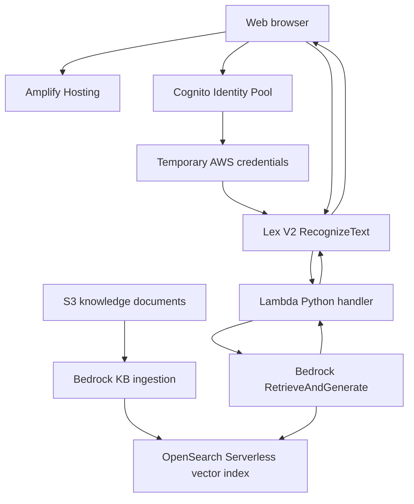

# Architecture and request lifecycle

## Security boundaries
- The browser receives only temporary credentials; the guest IAM role, if enabled, should allow only `lex:RecognizeText` for one alias.
- Lambda accesses Bedrock. Never expose model or knowledge-base permissions to the browser.
- S3 source documents stay private; Bedrock service roles require appropriate access.
- Lex alias and intent fulfillment hooks both need to be configured.
- This educational direct-to-Lex frontend has no per-user abuse control; require authentication or use a protected backend for public use.
